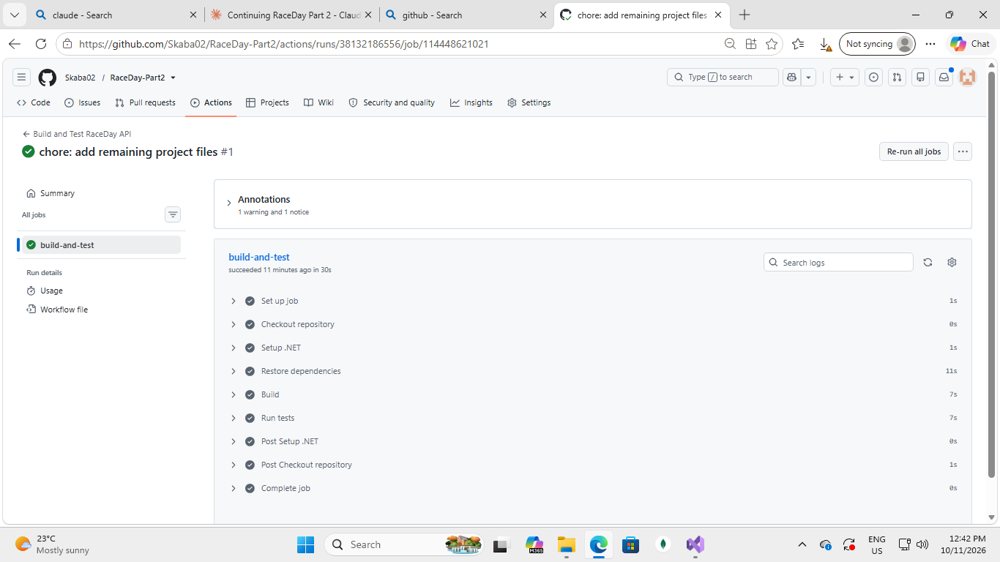

# RaceDay API – Part 2

A RESTful API for managing running events. Organisers create events and race categories and record results. Participants enrol in categories and view their own enrolments and results.

**Author:** Isaac Sekobotsane
**Student number:** ST10494173
**Module:** PROG6212
**Repository:** https://github.com/Skaba02/RaceDay-Part2
**Video walkthrough:** https://youtu.be/xvQdhjHERa8?si=giyKpG8fr3Hvzt0O


---

## 1. Technology

| Area | Choice |
|---|---|
| Framework | ASP.NET Core 8 Web API |
| Data access | Entity Framework Core 8 (code-first migrations) |
| Database | Microsoft SQL Server Express |
| Authentication | Session-based login with two roles: Organiser and Participant |
| Password storage | Hashed with ASP.NET Core `PasswordHasher` |
| API documentation | Swagger (OpenAPI 3.0) |
| Testing | xUnit integration tests using an in-memory database |
| CI | GitHub Actions |

## 2. Database

The schema follows the Part 1 design and has six tables: `Roles`, `Users`, `Events`, `Categories`, `Enrolments` and `Results`.

- The two roles are seeded: 1 = Organiser, 2 = Participant.
- Email addresses and role names are unique.
- A participant can enrol in the same category only once.
- Each enrolment can have at most one result.
- `DistanceKm` is stored as `decimal(18,2)`.

## 3. Setup

**You need:** .NET 8 SDK, SQL Server Express and Visual Studio 2022 (or any editor with the .NET CLI).

1. Clone the repository and open `RaceDay.sln`.
2. Open `RaceDay.Api/appsettings.json` and set the connection string for your own SQL Server instance, for example:
   ```json
   "DefaultConnection": "Server=.\\SQLEXPRESS;Database=RaceDayDb;Trusted_Connection=True;TrustServerCertificate=True;"
   ```
3. Create the database from the migrations:
   ```
   cd RaceDay.Api
   dotnet ef database update
   ```
4. Run the API (press F5 in Visual Studio, or use `dotnet run`).
5. Open Swagger at `https://localhost:7100/swagger`. The port may differ on your machine, so check the console output.

**Using the API:** call `POST /api/auth/register`, then `POST /api/auth/login`. Swagger keeps the session cookie, so the role-restricted endpoints then work.

## 4. Endpoints

**Auth** (no login needed)

| Method | Route | Purpose |
|---|---|---|
| POST | `/api/auth/register` | Create an account with the role Organiser or Participant |
| POST | `/api/auth/login` | Log in and start a session |
| POST | `/api/auth/logout` | End the session |

**Events**

| Method | Route | Access |
|---|---|---|
| GET | `/api/events` | Public |
| GET | `/api/events/{id}` | Public |
| POST | `/api/events` | Organiser |
| PUT | `/api/events/{id}` | Organiser who owns the event |
| DELETE | `/api/events/{id}` | Organiser who owns the event |

**Categories**

| Method | Route | Access |
|---|---|---|
| GET | `/api/events/{eventId}/categories` | Public |
| POST | `/api/events/{eventId}/categories` | Organiser who owns the event |
| PUT | `/api/categories/{id}` | Organiser who owns the event |
| DELETE | `/api/categories/{id}` | Organiser who owns the event |

**Enrolments**

| Method | Route | Access |
|---|---|---|
| POST | `/api/categories/{categoryId}/enrol` | Participant |
| GET | `/api/users/me/enrolments` | Participant (own enrolments) |
| GET | `/api/categories/{categoryId}/enrolments` | Organiser who owns the event |
| DELETE | `/api/enrolments/{id}` | Participant (own enrolment) |

**Results**

| Method | Route | Access |
|---|---|---|
| POST | `/api/enrolments/{enrolmentId}/result` | Organiser who owns the event |
| GET | `/api/categories/{categoryId}/results` | Public (ordered by position) |
| GET | `/api/users/me/results` | Participant (own results) |

**Users**

| Method | Route | Access |
|---|---|---|
| GET | `/api/users/me` | Any logged-in user |
| PUT | `/api/users/me` | Any logged-in user |

**Response codes:** 401 when not logged in, 403 when the role is wrong or the event belongs to another organiser, 404 when the record is not found, and 409 for duplicates (for example recording a second result for the same enrolment).

## 5. Tests

The test project `RaceDay.Api.Tests` starts the real API in memory and replaces SQL Server with an in-memory database, so no connection string is needed. Every controller has tests for success cases, role restrictions, ownership rules and unauthenticated access.

Run all tests from the solution folder:
```
dotnet test
```
**Result: 35 tests, 35 passed, 0 failed.**

## 6. Continuous integration

The workflow `.github/workflows/build-and-test.yml` runs on every push and pull request to `main`. It checks out the code, installs .NET 8, restores packages, builds in Release mode and runs the tests.



## 7. Version control

The history uses short prefixes such as `feat:`, `test:`, `chore:` and `docs:`. The commits follow the structure of the project: models, database context, migrations, DTOs, controllers and tests.

## 8. AI-use disclosure

In line with my institution's AI-use policy, I declare the following.

- **Tool used:** Claude (Anthropic), as an AI assistant.
- **How it was used:** troubleshooting the SQL Server connection and EF Core migration errors; correcting the structure of `appsettings.json`; adding decimal precision for `DistanceKm` in `RaceDayDbContext`; writing the Categories, Results and Users controller test files; setting up the Git repository and its commit history; and drafting this README.
-  The models, DTOs, controllers and the Auth, Events and Enrolments tests were generated with an AI assistant (Claude by Anthropic).  I read through the code, ran the application and the tests, and checked it against the Part 2 requirements and my Part 1 design.
- I ran and tested the final code (all 35 tests pass) and I am responsible for the work I am submitting.

## 9. References

[ADD THE PRESCRIBED TEXTBOOK FOR THIS MODULE IN APA FORMAT]

GitHub. (n.d.). *GitHub Actions documentation*. https://docs.github.com/actions

Microsoft. (n.d.). *ASP.NET Core documentation*. https://learn.microsoft.com/aspnet/core

Microsoft. (n.d.). *Entity Framework Core documentation*. https://learn.microsoft.com/ef/core

xUnit.net. (n.d.). *xUnit.net documentation*. https://xunit.net/
