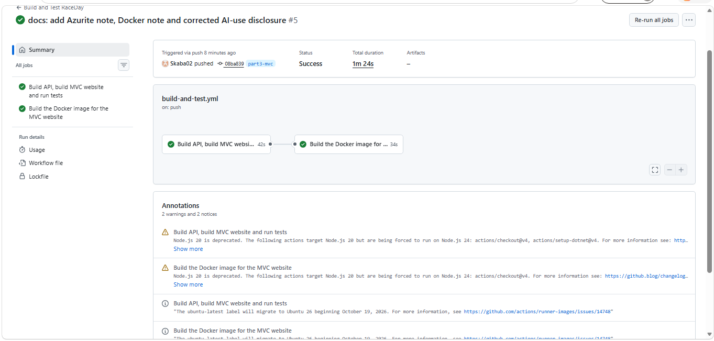

# RaceDay – Part 3: Web Application (MVC, Azure Blob Storage and Docker)

Part 3 adds the website for the RaceDay platform. The website is an ASP.NET Core MVC application that gets **all** of its data from the Part 2 API. Event banners and profile pictures are stored in **Azure Blob Storage** by the API, and the website runs inside a **Docker** container.

**Author:** Isaac Sekobotsane
**Student number:** ST10494173
**Module:** PROG6212
**Repository:** https://github.com/Skaba02/RaceDay-Part2 (branch `part3-mvc`)
**Video walkthrough:** [ADD YOUTUBE LINK]

Part 2 is described in [README-Part2.md](README-Part2.md).

---

## 1. How the parts fit together

```
 Browser  --->  RaceDay.Web (MVC website)  --->  RaceDay.Api  --->  SQL Server
                                                      |
                                                      +---------->  Azure Blob Storage
```

- **RaceDay.Web** has no database code and no business rules. Every page asks the API for data.
- **RaceDay.Api** owns the data, the rules, the login session and all file handling.
- **Azure Blob Storage** is only ever used by the API. The website never talks to Azure.

## 2. Project structure (RaceDay.Web)

| Folder | What it holds |
|---|---|
| `Controllers` | One controller per area: `Account`, `Home`, `Events` and `Participant` (Participant pages), `Organiser` (all Organiser pages), `Profile`, `Images` |
| `Services/ApiClient.cs` | The only class that calls the API. It keeps each user's API session cookie in that user's website session |
| `Filters` | `RequireLogin` and `RequireRole` keep protected pages away from visitors who are not logged in or have the wrong role |
| `Models` | `Api` holds the shapes of the JSON the API returns. `ViewModels.cs` holds the forms and their validation |
| `Helpers` | Session key names and display helpers (dates, "47th out of 312", status colours) |
| `Views` | The Razor pages, with a shared layout and partial views |
| `wwwroot/css/site.css` | The RaceDay theme (navy and orange) on top of Bootstrap 5 |
| `Dockerfile` | Builds and runs the website in a container |

## 3. Login, session and roles

1. A user registers or logs in on the website. The website sends the details to the API (`/api/auth/register`, `/api/auth/login`).
2. When the API accepts the login it starts its own session and returns a session cookie. The website keeps that cookie, the user's id and their role in the **website session**.
3. Every later request to the API carries that user's cookie, so the API knows who is calling and what role they have.
4. The `RequireLogin` and `RequireRole` filters check the website session. A visitor who is not logged in is sent to the login page, and a user with the wrong role sees an "access denied" page.
5. Log out clears both the API session and the website session. If the API ever says "not logged in" (for example after it restarts), the website ends the session and asks the user to log in again.

Each role has its own menu and pages.

## 4. Pages

**Organiser**

| Page | What it does |
|---|---|
| Dashboard | Events created, total enrolments, next event date, upcoming events and enrolments per event |
| My Events | Create, edit and delete events (name, description, date, location, distance, type) and upload a banner image |
| Categories | Add, edit and delete distance or age categories for an event |
| Enrolments | See everyone enrolled in an event with their category and status, and change the status |
| Results | Enter finish times and positions. Saved results are published immediately |
| Profile | Update details and upload a profile picture |

**Participant**

| Page | What it does |
|---|---|
| Find Events (home) | Upcoming events with filters: search text, type, location and date range |
| Event details | Full information, the banner image and the available categories, with an Enrol button |
| My Enrolments | Every event enrolled in, with a colour-coded status (green Confirmed, amber Pending) and a cancel button |
| My Results | Race history: event, date, category, finish time and position, for example "47th out of 312" |
| Profile | Update details and upload a profile picture |

The interface uses Bootstrap 5, one colour theme and the same fonts on every page. Wrong or missing input is answered with a short message next to the field. API problems are shown as a friendly message, never as a raw error.

## 5. What was added to the API for Part 3

| Method | Route | Who | Purpose |
|---|---|---|---|
| GET | `/api/events/search` | Public | Search upcoming events with filters |
| GET | `/api/events/{id}/details` | Public | Event with its categories and places taken |
| GET | `/api/organiser/dashboard` | Organiser | Totals and events with enrolment counts |
| GET | `/api/organiser/events/{eventId}/enrolments` | Organiser who owns the event | Everyone enrolled, with status and result |
| PUT | `/api/organiser/enrolments/{id}/status` | Organiser who owns the event | Set Pending or Confirmed |
| POST | `/api/organiser/events/{eventId}/banner` | Organiser who owns the event | Upload the event banner (to Blob Storage) |
| GET | `/api/images/events/{eventId}` | Public | The banner image |
| GET | `/api/me/enrolments` | Participant | My enrolments with event details |
| GET | `/api/me/results` | Participant | My race history with total finishers |
| GET | `/api/me/profile` | Logged in | My profile |
| POST / GET | `/api/me/profile-picture` | Logged in | Upload or fetch my profile picture |

Two Part 2 endpoints were also improved: deleting an event or a category that already has enrolments now returns a clear 409 message instead of a database error.

## 6. Azure Blob Storage

- Only `BlobStorageService` in the API talks to Blob Storage. The website sends the file to the API, and the API stores it.
- Banners go to the `event-banners` container and profile pictures to `profile-pictures`. The database remembers which blob belongs to which event or user.
- Only JPG, PNG and WEBP images up to 5 MB are accepted.
- Images are shown by the API reading the blob and returning it. The storage account does not need public access.
- If storage is not configured or not reachable, the API answers 503 and the website shows a friendly message.

**Setting the connection string.** Never put it in a file that goes to GitHub. Use user secrets:

```
dotnet user-secrets init --project RaceDay.Api
dotnet user-secrets set "BlobStorage:ConnectionString" "<your connection string>" --project RaceDay.Api
```

- For an Azure storage account, copy the connection string from the portal: *Storage account*, then *Security + networking*, then *Access keys*.
- For local testing without Azure, run the free **Azurite** emulator and use `UseDevelopmentStorage=true` as the connection string.

## 7. Running the application on your computer

You need the .NET 8 SDK, SQL Server and the setup from [README-Part2.md](README-Part2.md) (connection string and `dotnet ef database update`).

1. Create the database tables, including the new image tables:
   ```
   cd RaceDay.Api
   dotnet ef database update
   cd ..
   ```
2. Set the Blob Storage connection string (section 6).
3. Start the API (leave it running):
   ```
   dotnet run --project RaceDay.Api
   ```
4. Start the website in a second window:
   ```
   dotnet run --project RaceDay.Web
   ```
5. Open https://localhost:7200 (or http://localhost:5200). Register one Organiser and one Participant to try both sides.

## 8. Running the website in Docker

The website runs in a container. The API still runs on your computer, so the container is told where to find it.

1. Start the API so that the container can reach it (leave it running):
   ```
   $env:DisableHttpsRedirection = "true"
   dotnet run --project RaceDay.Api --urls "http://0.0.0.0:5100"
   ```
2. Start the website with **one command**:
   ```
   docker compose up --build
   ```
3. Open http://localhost:8080.

The same thing without Compose:

```
docker build -t raceday-web ./RaceDay.Web
docker run --rm -p 8080:8080 -e ApiBaseUrl=http://host.docker.internal:5100 --add-host=host.docker.internal:host-gateway raceday-web
```

Stop it with `Ctrl + C` (or `docker compose down`). The container behaves exactly like the local version, because the only difference is the `ApiBaseUrl` setting.

**About the Dockerfile.** It uses two stages: the .NET SDK image builds and publishes the site, and the much smaller ASP.NET runtime image runs it. The project file is copied first so the package restore is cached, and the container runs as a non-root user.

## 9. Tests and CI

- The API tests (xUnit) now total 45. The new `Part3ApiTests` cover search filters, event details, the Organiser dashboard, role rules, my enrolments, my results, the delete conflict and the image upload when storage is not set up.
- The GitHub Actions workflow `.github/workflows/build-and-test.yml` runs on every push to `main` and `part3-mvc`. It restores the solution, builds the API **and the MVC project**, runs the tests, and then builds the Docker image.



## 10. Version control

Part 3 work lives on the `part3-mvc` branch, so the submitted Part 2 on `main` stays unchanged. Commits use the prefixes `feat:`, `fix:`, `test:`, `ci:` and `docs:`, and follow the structure of the work: API additions first, then the website, then Docker, CI and documentation.

## 11. AI-use disclosure

In line with my institution's AI-use policy, I declare the following.

- **Tool used:** Claude (Anthropic), as an AI assistant.
- **How it was used:** the Part 3 additions were generated with the assistant. These are the RaceDay.Web MVC website (controllers, views and styling), the new API endpoints and Blob Storage service, the Dockerfile and Compose file, the updated CI workflow, this README and the video script. The Part 2 disclosure in [README-Part2.md](README-Part2.md) still applies.
- I read the code, ran the API and the website, tested the pages for both roles, ran the tests and the Docker container, and I am responsible for the work I am submitting.

## 12. References

[ADD THE PRESCRIBED TEXTBOOK FOR THIS MODULE IN APA FORMAT]

Bootstrap. (n.d.). *Bootstrap documentation*. https://getbootstrap.com/docs/5.3

Docker Inc. (n.d.). *Docker documentation*. https://docs.docker.com

GitHub. (n.d.). *GitHub Actions documentation*. https://docs.github.com/actions

Microsoft. (n.d.). *ASP.NET Core documentation*. https://learn.microsoft.com/aspnet/core

Microsoft. (n.d.). *Azure Blob Storage documentation*. https://learn.microsoft.com/azure/storage/blobs

Microsoft. (n.d.). *Use the Azurite emulator for local Azure Storage development*. https://learn.microsoft.com/azure/storage/common/storage-use-azurite
